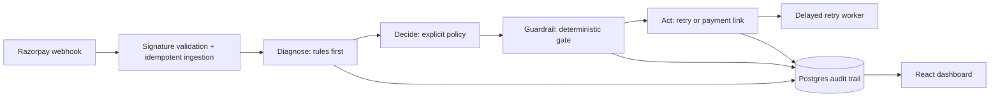

# RecoverAI Architecture

RecoverAI receives failed-payment webhooks, classifies the failure, selects a bounded action, and exposes the resulting audit trail in the dashboard.

## Diagnose

Razorpay error codes and descriptions are classified with deterministic rules first. Ambiguous failures can use the configured LLM classifier, but its reasoning is stored as diagnosis data and does not execute an action.

## Decide

The policy maps a diagnosis and retry history to an explicit action: schedule a bounded retry, create a payment link, escalate for manual review, or mark the episode dead.

## Guardrail

The guardrail is a pure deterministic gate. It blocks recovery after mandate cancellation, enforces the maximum retry count, and enforces the retry cooldown. Its verdict is persisted to `audit_log` before any external call.

## Act

The executor is the only path that invokes the injected Razorpay client. The retry worker reuses the same decision and guardrail path for due retries. A simulated client powers the synthetic batch, so local measurement never makes live payment calls.

Webhook signatures are verified over the raw request body before parsing, and the Razorpay event ID is protected by a database uniqueness constraint so redeliveries are ingested once.